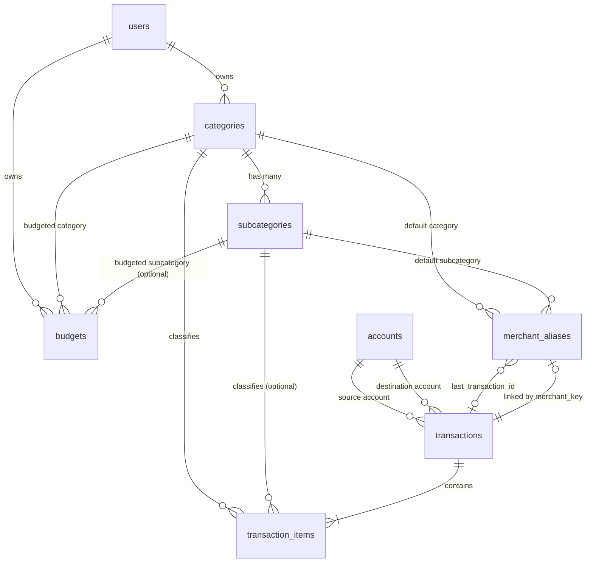
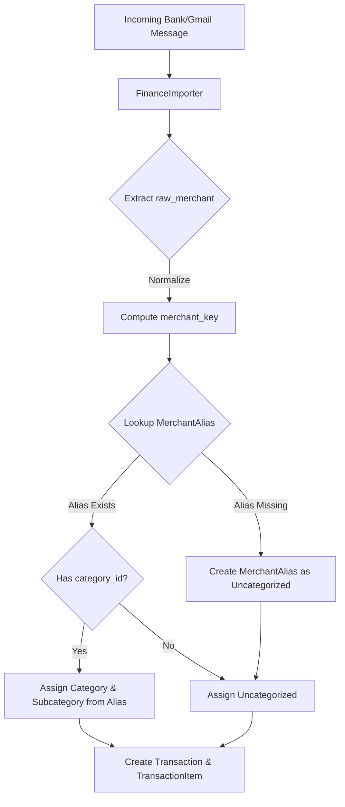
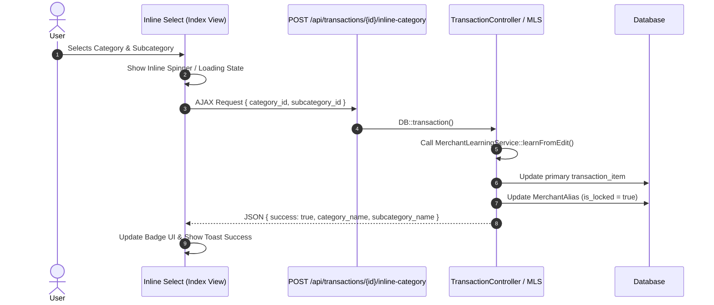
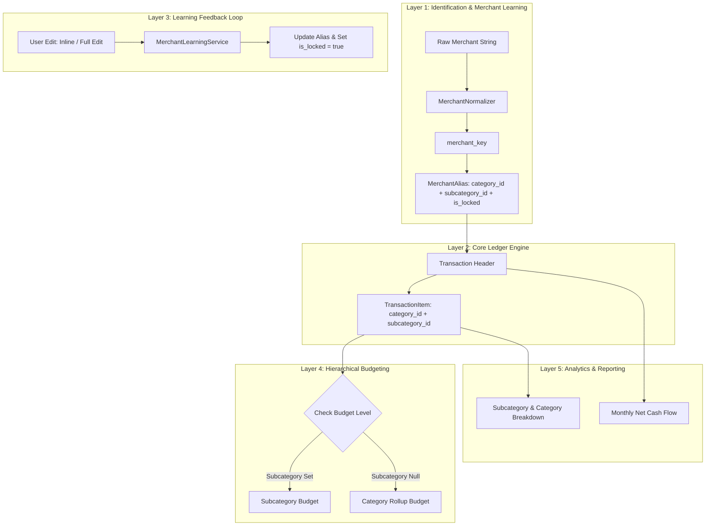

# Category → Subcategory Workflow Audit & Architecture Report

> **Audit Date:** August 6, 2026  
> **Target Application:** Financial OS (vFOS 2.0)  
> **Status:** AUDIT ONLY — Zero Code Modifications / Zero Migrations Executed  

---

## Executive Summary

This document provides a comprehensive, end-to-end technical audit of the **Category → Subcategory** workflow within vFOS. The application evolved from a legacy Google Sheets financial tracking system (in use since 2019) where transactions were categorized using a strict two-level hierarchy:

$$\text{Transaction} \longrightarrow \text{Category} \longrightarrow \text{Subcategory}$$

This audit evaluates the current database schema, transaction editing flows, reporting mechanisms, budgeting model, merchant learning system, transaction list UI capabilities, and provides a future-proof architectural recommendation for **Merchant Learning v2** and **Inline List Editing**.

---

## 1. Current Database Schema

The core financial structure relies on six main tables: `categories`, `subcategories`, `transactions`, `transaction_items`, `merchant_aliases`, and `budgets`.

### 1.1 Detailed Schema Breakdown

#### A. `categories` Table
* **Purpose:** High-level categorization of income and expenses (e.g., Food, Bills, Transport).
* **Schema Definition:**
  * `id` (`bigint unsigned`, PK, auto-increment)
  * `user_id` (`bigint unsigned`, FK $\rightarrow$ `users.id`, `NULLABLE`, `onDelete cascade`)
  * `owner` (`enum('afin', 'pacar', 'business')`, `DEFAULT 'afin'`)
  * `name` (`varchar(255)`, `NOT NULL`)
  * `type` (`enum('income', 'expense')`, `NOT NULL`)
  * `is_active` (`boolean`, `DEFAULT true`)
  * `is_ignored` (`boolean`, `DEFAULT false`) — *Used to exclude transfers/internal movements from cash flow reports*
  * `created_at`, `updated_at` (`timestamp`, `NULLABLE`)
* **Indexes:** Primary Key (`id`), FK index on `user_id`.

#### B. `subcategories` Table
* **Purpose:** Granular breakdown under a specific parent category (e.g., Food $\rightarrow$ Meals, Cafe, Snacks).
* **Schema Definition:**
  * `id` (`bigint unsigned`, PK, auto-increment)
  * `category_id` (`bigint unsigned`, FK $\rightarrow$ `categories.id`, `NOT NULL`, `onDelete cascade`)
  * `name` (`varchar(255)`, `NOT NULL`)
  * `is_active` (`boolean`, `DEFAULT true`)
  * `created_at`, `updated_at` (`timestamp`, `NULLABLE`)
* **Indexes:** Primary Key (`id`), FK index on `category_id`.

#### C. `transactions` Table (Header)
* **Purpose:** Header record representing a financial event, source account, total amount, and raw merchant context.
* **Schema Definition:**
  * `id` (`bigint unsigned`, PK, auto-increment)
  * `external_id` (`varchar(255)`, `NULLABLE`) — *Gmail message ID for idempotency*
  * `account_id` (`bigint unsigned`, FK $\rightarrow$ `accounts.id`, `NOT NULL`)
  * `to_account_id` (`bigint unsigned`, FK $\rightarrow$ `accounts.id`, `NULLABLE`) — *Used for transfers*
  * `type` (`enum('income', 'expense', 'transfer', 'withdrawal')`, `NOT NULL`)
  * `transaction_date` (`date`, `NOT NULL`)
  * `total_amount` (`decimal(15,2)`, `NOT NULL`)
  * `notes` (`text`, `NULLABLE`)
  * `merchant_key` (`varchar(255)`, `NULLABLE`, `INDEX`) — *Normalized lookup key for merchant learning*
  * `raw_merchant` (`varchar(255)`, `NULLABLE`) — *Original merchant string from parser*
  * `created_at`, `updated_at` (`timestamp`, `NULLABLE`)
* **Indexes:** Primary Key (`id`), FK on `account_id`, FK on `to_account_id`, Index on `merchant_key`.

#### D. `transaction_items` Table (Line Items)
* **Purpose:** Specific line-item allocations containing category, subcategory, amount, and description.
* **Schema Definition:**
  * `id` (`bigint unsigned`, PK, auto-increment)
  * `transaction_id` (`bigint unsigned`, FK $\rightarrow$ `transactions.id`, `NOT NULL`, `onDelete cascade`)
  * `category_id` (`bigint unsigned`, FK $\rightarrow$ `categories.id`, `NOT NULL`)
  * `subcategory_id` (`bigint unsigned`, FK $\rightarrow$ `subcategories.id`, `NULLABLE`)
  * `description` (`varchar(255)`, `NULLABLE`)
  * `amount` (`decimal(15,2)`, `NOT NULL`)
  * `created_at`, `updated_at` (`timestamp`, `NULLABLE`)
* **Indexes:** Primary Key (`id`), FK on `transaction_id`, FK on `category_id`, FK on `subcategory_id`.

#### E. `merchant_aliases` Table (Knowledge Base)
* **Purpose:** Stores learned mappings from normalized merchant keys to Category & Subcategory.
* **Schema Definition:**
  * `id` (`bigint unsigned`, PK, auto-increment)
  * `merchant_key` (`varchar(255)`, `UNIQUE`, `NOT NULL`)
  * `raw_merchant` (`varchar(255)`, `NOT NULL`)
  * `display_name` (`varchar(255)`, `NOT NULL`)
  * `category_id` (`bigint unsigned`, FK $\rightarrow$ `categories.id`, `NULLABLE`, `onDelete set null`)
  * `subcategory_id` (`bigint unsigned`, FK $\rightarrow$ `subcategories.id`, `NULLABLE`, `onDelete set null`)
  * `usage_count` (`integer`, `DEFAULT 1`)
  * `auto_categorized_count` (`integer`, `DEFAULT 0`)
  * `confidence` (`decimal(5,2)`, `DEFAULT 1.00`)
  * `is_locked` (`boolean`, `DEFAULT false`) — *True when user manually updates category/subcategory*
  * `last_transaction_id` (`bigint unsigned`, FK $\rightarrow$ `transactions.id`, `NULLABLE`, `onDelete set null`)
  * `first_seen_at` (`timestamp`, `NULLABLE`)
  * `last_seen_at` (`timestamp`, `NULLABLE`)
  * `created_at`, `updated_at` (`timestamp`, `NULLABLE`)
* **Indexes:** Primary Key (`id`), Unique on `merchant_key`, FK on `category_id`, FK on `subcategory_id`, FK on `last_transaction_id`.

#### F. `budgets` Table
* **Purpose:** Monthly spending targets assigned per Category or per Subcategory.
* **Schema Definition:**
  * `id` (`bigint unsigned`, PK, auto-increment)
  * `user_id` (`bigint unsigned`, FK $\rightarrow$ `users.id`, `NULLABLE`, `onDelete cascade`)
  * `owner` (`enum('afin', 'pacar', 'business')`, `DEFAULT 'afin'`)
  * `category_id` (`bigint unsigned`, FK $\rightarrow$ `categories.id`, `NOT NULL`)
  * `subcategory_id` (`bigint unsigned`, FK $\rightarrow$ `subcategories.id`, `NULLABLE`, `onDelete cascade`)
  * `month` (`tinyint`, `NOT NULL`)
  * `year` (`integer`, `NOT NULL`)
  * `allocated_amount` (`decimal(15,2)`, `NOT NULL`)
  * `created_at`, `updated_at` (`timestamp`, `NULLABLE`)
* **Indexes:** Primary Key (`id`), FK on `user_id`, FK on `category_id`, FK on `subcategory_id`.

---

### 1.2 Entity Relationship Map



---

## 2. Current Editing Flow

### 2.1 Sequence Architecture

When a transaction is edited, the current execution pipeline follows this explicit chain:

```mermaid
sequenceDiagram
    autonumber
    actor User
    participant View as edit.blade.php
    participant Controller as TransactionController@update
    participant MLS as MerchantLearningService
    participant DB as Database (Transactions & Items)

    User->>View: Submit Form (account, date, items[category_id, subcategory_id, amount])
    View->>Controller: PUT /transactions/{id}
    Controller->>Controller: Validate items.*.category_id & items.*.subcategory_id
    Controller->>Controller: Compute totalAmount = sum(items.amount)
    
    rect rgb(20, 30, 45)
        note right of Controller: DB::transaction()
        Controller->>MLS: learnFromEdit($transaction, $newCategoryId, $newSubcategoryId)
        alt Category or Subcategory changed AND merchant_key exists
            MLS->>DB: Upsert MerchantAlias (category_id, subcategory_id, is_locked=true)
        end
        Controller->>DB: $transaction->update([...])
        Controller->>DB: $transaction->transactionItems()->delete()
        Controller->>DB: Re-create transactionItems
    end
    
    Controller->>User: Redirect to transactions.index with success toast
```



### 2.2 Storage Analysis: Where Category & Subcategory Live

1. **Transaction Storage Location:**  
   Category and Subcategory are **NOT** stored directly on the `transactions` table. They reside exclusively on `transaction_items` (`category_id` mandatory, `subcategory_id` nullable).
2. **Merchant Learning Location:**  
   `merchant_aliases` stores the learned default `category_id` and `subcategory_id` associated with a `merchant_key`.
3. **Execution Hook:**  
   During `TransactionController@update`, `MerchantLearningService::learnFromEdit()` inspects the first item (`items[0]`) submitted. If the user changed `category_id` or `subcategory_id` from the existing record, `MerchantAlias` is updated and marked `is_locked = true`.

---

## 3. Current Reporting Flow

### 3.1 Data Sources for Reports & Dashboard

| Report Component | Primary Table Read | Secondary Table / Join | Calculation Strategy |
| :--- | :--- | :--- | :--- |
| **Monthly Income Total** | `transactions` | `transaction_items.category` | `sum(transactions.total_amount)` filtered by month/year where Category `is_ignored = false`. |
| **Monthly Expense Total** | `transactions` | `transaction_items.category` | `sum(transactions.total_amount)` filtered by month/year where Category `is_ignored = false`. |
| **Cashflow Trend Chart (12 Months)** | `transactions` | `transaction_items.category` | Grouped by month/year `sum(total_amount)` for income and expense excluding ignored categories. |
| **Expenses by Category (Donut)** | `transaction_items` | `transactions`, `categories`, `accounts` | `selectRaw('categories.name, sum(transaction_items.amount)')` grouped by category name. |
| **Expenses by Subcategory (Donut)** | `transaction_items` | `transactions`, `subcategories`, `categories` | `selectRaw("COALESCE(subcategories.name, 'Uncategorized'), sum(amount)")` grouped by subcategory name. |
| **Budget vs Actual (Dashboard)** | `categories` | `transaction_items`, `budgets` | Sums `transaction_items.amount` per category and compares with `budgets.allocated_amount`. |
| **Budget Management Index** | `budgets` | `transaction_items` | Sums `transaction_items.amount` filtering by `subcategory_id` if set, else `category_id`. |

### 3.2 Source of Truth Analysis

* **Header Level (`transactions`):** Used as the source of truth for net cash movements, account balances, and overall monthly totals.
* **Granular Level (`transaction_items`):** The **ultimate source of truth** for all categorical breakdowns, subcategory distributions, and budget consumption. `transactions.total_amount` is an aggregate header sum derived from its child `transaction_items`.

---

## 4. Budget Flow

### 4.1 Schema & Linking Model

Budgets in vFOS support a **flexible dual-level hierarchy**:

$$\text{Budget} \longrightarrow \begin{cases} \text{Category Only} & (\text{subcategory\_id is } \text{NULL}) \\ \text{Category + Subcategory} & (\text{subcategory\_id is } \text{NOT NULL}) \end{cases}$$

### 4.2 Actual Spending Calculation Logic

In `BudgetController@index`, actual spent amounts are calculated dynamically per budget entry:

```php
$query = TransactionItem::whereHas('transaction', function ($q) use ($month, $year, $userId) {
    $q->whereMonth('transaction_date', $month)
      ->whereYear('transaction_date', $year)
      ->whereHas('account', fn($aq) => $aq->where('user_id', $userId));
});

if ($budget->subcategory_id) {
    // Granular budget: Matches exact subcategory
    $query->where('subcategory_id', $budget->subcategory_id);
} else {
    // Parent category budget: Matches all items under category
    $query->where('category_id', $budget->category_id);
}

$spent = $query->sum('amount');
```

---

## 5. Merchant Learning Engine

### 5.1 Current Capability Audit

> **Key Finding:** The underlying database schema, `MerchantLearningService`, and `FinanceImporter` **already support Subcategories**!

#### Feature Support Checklist
* [x] Schema supports `subcategory_id` on `merchant_aliases`
* [x] `MerchantLearningService::learnFromEdit()` accepts `$newSubcategoryId`
* [x] `MerchantAlias` saves `subcategory_id` when updated or created
* [x] `FinanceImporter` resolves `subcategory_id` from `MerchantAlias` during automated ingestion
* [x] `FinanceImporter` passes `subcategory_id` into `transaction_items` creation
* [ ] UI displays subcategory badges on transaction list page (`transactions/index.blade.php`)
* [ ] UI allows inline selection of Category & Subcategory without opening Edit page

#### Automated Import Categorization Flow



---

## 6. Transaction List Page Audit (Inline Dropdowns)

### 6.1 Feasibility Assessment

**Can `transactions/index.blade.php` safely support inline Category and Subcategory dropdowns without opening the Edit page?**

**YES**, subject to key architectural conditions outlined below.

### 6.2 Pros, Cons & Trade-Offs

#### Pros
1. **High Efficiency:** Users can rapidly clean up and categorize dozens of newly imported transactions directly in the table.
2. **Instant Machine Learning:** Each inline change triggers `MerchantLearningService::learnFromEdit()`, training future imports instantly.
3. **Reduced Friction:** Eliminates page loads and modal navigations.

#### Cons & Technical Risks
1. **Multi-Item (Split) Transactions:** A transaction can have multiple line items. Inline dropdowns on a single row assume 1 primary line item.
2. **Cascading Dropdown Dependency:** Selecting Category must dynamically populate/filter Subcategory options for that specific row.
3. **Summary Card Synchronization:** Changing a category to/from an `is_ignored` category affects header totals (Income, Expense, Net Savings) without a full page refresh.

### 6.3 Proposed Inline Editing Architecture



---

## 7. Future Workflow Recommendations

Based on the Excel system operational since 2019, the recommended end-to-end architecture is structured into five cohesive operational layers:

### 7.1 Architecture Layers



### 7.2 Core Recommendations Summary

1. **UI Evolution (Phase 1):**
   * Update `transactions/index.blade.php` to display **both** Category and Subcategory badges.
   * Implement an AJAX-powered inline dropdown pair (Category $\rightarrow$ Subcategory) for single-item transactions.

2. **Merchant Learning v2 (Phase 2):**
   * Retain `is_locked` semantics: Manual user intervention permanently locks the `(Category, Subcategory)` pair for that `merchant_key`.
   * Add confidence scoring and display auto-categorization status badges on the ledger.

3. **Budget Engine Alignment (Phase 3):**
   * Standardize Dashboard "Budget vs Actual" to honor Subcategory-level budgets alongside Category-level rollups.

4. **Data Integrity Enforcement (Phase 4):**
   * Add database level / model validation ensuring that if `subcategory_id` is assigned, its `category_id` must match `subcategories.category_id`.

---

> **Audit Conclusion:** The database schema and backend services are **90% ready** for complete Category $\rightarrow$ Subcategory Merchant Learning. The primary gap is UI presentation and inline interaction on `transactions/index.blade.php`.
