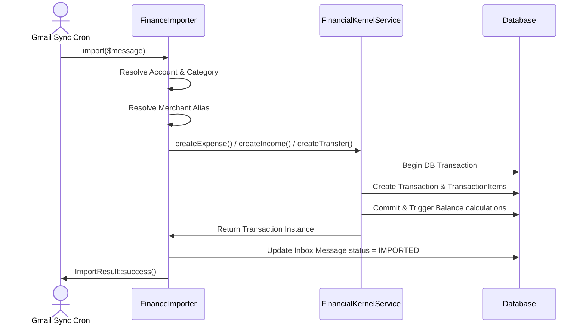

# FinanceImporter ➔ FinancialKernel Migration

This document records the migration of the automated import pipeline (`FinanceImporter`) to use the new `FinancialKernelService` as its backend engine.

---

## 1. Flow Comparison

### Previous Flow
```
Gmail Inbox Sync ➔ Parser Manager ➔ FinanceImporter ➔ Transaction::create() ➔ TransactionItem::create() ➔ Refresh Balances
```
* **Issues**: Subsystem-specific database insertions bypass domain-level restrictions, increasing risk of schema changes or transaction isolation errors breaking balance consistency.

### New Flow
```
Gmail Inbox Sync ➔ Parser Manager ➔ FinanceImporter ➔ FinancialKernelService ➔ Database transaction (ACID)
```
* **Benefits**: Decouples importers entirely from Eloquent operations. Balance recalculations and transactions are wrapped inside the Financial Kernel Service facade.

---

## 2. Sequence Diagram



---

## 3. Modified & Created Files

### Modified Files
* [FinanceImporter.php](file:///c:/laragon/www/Vfos/app/Services/Finance/FinanceImporter.php): Injected `FinancialKernelService` and removed `Transaction::create()` / `TransactionItem::create()` calls.
* [FinancialKernelService.php](file:///c:/laragon/www/Vfos/app/Services/Finance/Kernel/FinancialKernelService.php): Added support for `item_description` custom metadata fallback.

### Created Files
* [FinanceImporterKernelIntegrationTest.php](file:///c:/laragon/www/Vfos/tests/Feature/Finance/FinanceImporterKernelIntegrationTest.php): End-to-end integration tests verifying income, expense, transfer, duplicate, merchant alias updates, and transaction rollback operations.

---

## 4. Risks & Mitigations

* **Risk**: Missing custom transaction item descriptions.
  - *Mitigation*: Updated `FinancialKernelService` to respect a custom `item_description` passed via `$metadata`, falling back to transaction notes.
* **Risk**: Database unique constraint conflicts on message IDs.
  - *Mitigation*: Fixed by seeding existing transaction records inside the test environment instead of saving duplicate inbox messages.

---

## 5. Future Migration Opportunities
Now that `FinanceImporter` successfully delegates all mutations to the Kernel, the next step is migrating `TransactionController` (manual web requests) to use `FinancialKernelService` for storing and updating ledger transactions.
