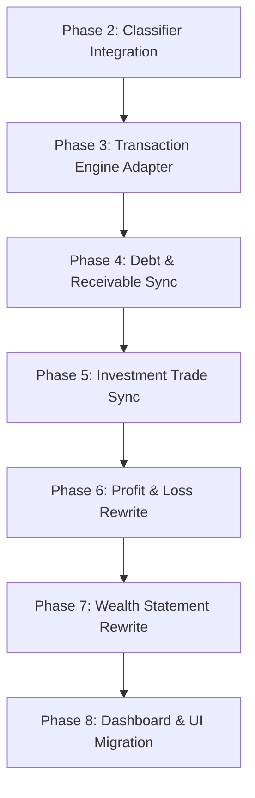

# Financial Event Mapping Audit & Specification

This document serves as the definitive mapping specification and transition blueprint for the vFOS 2.0 Financial Engine. It establishes the business rules, data mappings, and migration roadmaps for the upcoming evolution to the Financial Event architecture.

---

## Part 1. Current Architecture Mapping

The legacy transaction engine relies on a cash-flow model. It classifies transactions into four types:

### 1. Income
* **Current Meaning:** Cash coming into the system from external sources.
* **Current Database Effect:** Creates a record in `transactions` (type = `income`) and child items in `transaction_items`.
* **Account Balance Effect:** Increases `total_balance` of the designated `account_id`.
* **Profit & Loss Effect:** Directly increases Net Income (unless the associated category is marked as `is_ignored`).
* **Wealth Statement Effect:** Indirectly increases Net Worth by inflating liquid cash balances.
* **Current Weaknesses:** Any incoming value is treated as income. If a user receives a repayment of a loan (receivable collection) or receives loan capital (debt creation), it is logged as `income`, which incorrectly inflates the P/L.

### 2. Expense
* **Current Meaning:** Cash leaving the system to external entities.
* **Current Database Effect:** Creates a record in `transactions` (type = `expense`) and child items in `transaction_items`.
* **Account Balance Effect:** Decreases `total_balance` of the designated `account_id`.
* **Profit & Loss Effect:** Directly increases Expenses (reducing Net Profit).
* **Wealth Statement Effect:** Indirectly decreases Net Worth by reducing cash balances.
* **Current Weaknesses:** Any cash outflow that is not an internal transfer is logged as an `expense`. If a user buys investments (stocks, gold), pays down debt principal, or lends money, the transaction is marked as an `expense`, showing a false reduction in profitability on the P/L.

### 3. Transfer
* **Current Meaning:** Moving cash internally between the user's own liquid accounts.
* **Current Database Effect:** Creates a record in `transactions` (type = `transfer`, populating both `account_id` and `to_account_id`) and a child item in `transaction_items`.
* **Account Balance Effect:** Decreases `total_balance` of the source account and increases `total_balance` of the destination account.
* **Profit & Loss Effect:** None (the query explicitly filters out `transfer` type transactions).
* **Wealth Statement Effect:** Asset allocation changes, but overall net worth remains unchanged.
* **Current Weaknesses:** There is no sub-ledger integration. For example, transferring cash to purchase an investment portfolio or to fund an e-wallet is treated as a simple account transfer, failing to register the asset conversion.

### 4. Withdrawal
* **Current Meaning:** Cash physically taken out of an account (often converting bank balance to cash-on-hand).
* **Current Database Effect:** Creates a record in `transactions` (type = `withdrawal`) and child items in `transaction_items`.
* **Account Balance Effect:** Decreases `total_balance` of the designated `account_id`.
* **Profit & Loss Effect:** Included as an expense if associated with an active category; otherwise excluded.
* **Wealth Statement Effect:** Decreases bank balances.
* **Current Weaknesses:** Conceptually identical to a transfer (moving bank funds to cash-on-hand), yet it is modeled separately and sometimes logged as an expense depending on the category mapping, which distorts ledger integrity.

---

## Part 2. Real World Financial Events Master Mapping Table

This table maps real-world financial actions to legacy transaction types and future Financial Event types, outlining their respective balance sheet and income statement impacts.

| Real World Event | Example | Current Type | Future Event Type | Cash Effect | Asset Effect | Liability Effect | P/L Effect | Wealth Statement | Special Handling? |
| :--- | :--- | :--- | :--- | :---: | :---: | :---: | :---: | :---: | :---: |
| **Salary received** | Monthly paycheck | Income | `VALUE_CREATION` | $+X$ | $+X$ (Cash) | Neutral | $+X$ (Income) | $+X$ (Net Worth) | No |
| **Bonus** | Performance bonus | Income | `VALUE_CREATION` | $+X$ | $+X$ (Cash) | Neutral | $+X$ (Income) | $+X$ (Net Worth) | No |
| **Interest received** | Savings account interest | Income | `VALUE_CREATION` | $+X$ | $+X$ (Cash) | Neutral | $+X$ (Income) | $+X$ (Net Worth) | No |
| **QRIS purchase** | Food at restaurant | Expense | `VALUE_CONSUMPTION` | $-X$ | $-X$ (Cash) | Neutral | $+X$ (Expense) | $-X$ (Net Worth) | No |
| **Cash withdrawal** | ATM Withdrawal | Withdrawal | `INTERNAL_TRANSFER` | Bank $-X$ | Cash $+X$ | Neutral | Neutral | Neutral | Yes (Map to Cash account) |
| **Cash deposit** | CDM Deposit | Income | `INTERNAL_TRANSFER` | Bank $+X$ | Cash $-X$ | Neutral | Neutral | Neutral | Yes (Map from Cash account) |
| **Transfer own accounts** | Mandiri $\rightarrow$ BCA | Transfer | `INTERNAL_TRANSFER` | Mandiri $-X$ | BCA $+X$ | Neutral | Neutral | Neutral | No |
| **Transfer Mandiri $\rightarrow$ BCA** | Self-transfer | Transfer | `INTERNAL_TRANSFER` | Mandiri $-X$ | BCA $+X$ | Neutral | Neutral | Neutral | No |
| **Transfer BCA $\rightarrow$ GoPay** | E-wallet topup | Transfer | `INTERNAL_TRANSFER` | BCA $-X$ | GoPay $+X$ | Neutral | Neutral | Neutral | Yes (Needs GoPay Account) |
| **Topup ShopeePay** | Topup ShopeePay | Transfer | `INTERNAL_TRANSFER` | Bank $-X$ | Shopee $+X$ | Neutral | Neutral | Neutral | Yes (Needs Shopee Account) |
| **Topup DANA** | Topup DANA | Transfer | `INTERNAL_TRANSFER` | Bank $-X$ | DANA $+X$ | Neutral | Neutral | Neutral | Yes (Needs DANA Account) |
| **Buy Stock** | Purchase 1 lot BBRI | Expense | `ASSET_ACQUISITION` | $-X$ | Stock $+X$ | Neutral | Neutral | Asset Swap | Yes (Increase Stock Qty) |
| **Sell Stock (profit)** | Sell BBRI at gain | Income | `ASSET_DISPOSAL` | $+X$ | Stock $-Principal$ | Neutral | $+Gain$ (Income) | $+Gain$ (Net Worth) | Yes (Realize P/L split) |
| **Sell Stock (loss)** | Sell BBRI at loss | Income | `ASSET_DISPOSAL` | $+X$ | Stock $-Principal$ | Neutral | $-Loss$ (Expense) | $-Loss$ (Net Worth) | Yes (Realize P/L split) |
| **Gold purchase** | Buy 5g Antam | Expense | `ASSET_ACQUISITION` | $-X$ | Gold $+X$ | Neutral | Neutral | Asset Swap | Yes (Increase Gold Qty) |
| **Gold sale** | Sell 5g Antam | Income | `ASSET_DISPOSAL` | $+X$ | Gold $-Principal$ | Neutral | $+Gain / -Loss$ | $+Gain / -Loss$ | Yes (Realize P/L split) |
| **Create Receivable** | Lending money to friend | Expense | `ASSET_ACQUISITION` | $-X$ | Receivable $+X$ | Neutral | Neutral | Asset Swap | Yes (Create Receivable record) |
| **Friend repays loan** | Cash collection of loan | Income | `ASSET_DISPOSAL` | $+X$ | Receivable $-X$ | Neutral | Neutral | Asset Swap | Yes (Reduce Receivable principal) |
| **Write off bad debt** | Loan unrecoverable | Expense | `VALUE_CONSUMPTION` | Neutral | Receivable $-X$ | Neutral | $+X$ (Expense) | $-X$ (Net Worth) | Yes (Close Receivable) |
| **Create Debt** | Getting a bank loan | Income | `LIABILITY_CREATION` | $+X$ | $+X$ (Cash) | Debt $+X$ | Neutral | Debt Swap (neutral) | Yes (Create Debt record) |
| **Bank loan received** | Disbursed loan | Income | `LIABILITY_CREATION` | $+X$ | $+X$ (Cash) | Debt $+X$ | Neutral | Debt Swap (neutral) | Yes (Create Debt record) |
| **Principal repayment** | Paying down mortgage | Expense | `LIABILITY_REDUCTION` | $-X$ | Neutral | Debt $-X$ | Neutral | Debt Swap (neutral) | Yes (Reduce Debt principal) |
| **Interest repayment** | Paying bank interest | Expense | `VALUE_CONSUMPTION` | $-X$ | Neutral | Neutral | $+X$ (Expense) | $-X$ (Net Worth) | Yes (Expense entry) |
| **Credit card payment** | Paying bill from bank | Transfer | `INTERNAL_TRANSFER` | Bank $-X$ | Neutral | CC Debt $-X$ | Neutral | Debt Swap (neutral) | Yes (If CC modeled as Account) |
| **Mortgage payment** | Monthly mortgage installment | Expense | `UNKNOWN` | $-X$ | Neutral | Debt $-Principal$ | $+Interest$ (Expense) | $-Interest$ | Yes (Must split split items) |
| **Mortgage principal** | Principal split | Expense | `LIABILITY_REDUCTION` | $-X$ | Neutral | Debt $-X$ | Neutral | Debt Swap | Yes (Map to Debt subcategory) |
| **Mortgage interest** | Interest split | Expense | `VALUE_CONSUMPTION` | $-X$ | Neutral | Neutral | $+X$ (Expense) | $-X$ (Net Worth) | Yes (Map to Interest category) |
| **Buy motorcycle** | Cash purchase | Expense | `ASSET_ACQUISITION` | $-X$ | Vehicle $+X$ | Neutral | Neutral | Asset Swap | Yes (Create Asset record) |
| **Sell motorcycle** | Sell used vehicle | Income | `ASSET_DISPOSAL` | $+X$ | Vehicle $-Principal$ | Neutral | $+Gain / -Loss$ | $+Gain / -Loss$ | Yes (Realize gain/loss split) |
| **Depreciation adjustment**| Vehicle value reduction | Expense | `VALUATION_ADJUSTMENT` | Neutral | Vehicle $-X$ | Neutral | $+X$ (Expense) | $-X$ (Net Worth) | Yes (Non-cash entry) |
| **Manual cash adjustment**| Physical wallet check | Expense | `VALUATION_ADJUSTMENT` | $-X$ | Neutral | Neutral | $+X$ (Expense) | $-X$ (Net Worth) | Yes (P/L if reconciled) |
| **Inventory purchase** | Resellable goods | Expense | `ASSET_ACQUISITION` | $-X$ | Inventory $+X$ | Neutral | Neutral | Asset Swap | Yes (Future implementation) |
| **Inventory sale** | Selling stock to client | Income | `VALUE_CREATION` | $+X$ | Inventory $-COGS$ | Neutral | $+Profit$ (Income) | $+Profit$ (Net Worth) | Yes (Future COGS tracking) |
| **Dividend received** | Stock dividend payout | Income | `VALUE_CREATION` | $+X$ | $+X$ (Cash) | Neutral | $+X$ (Income) | $+X$ (Net Worth) | No |
| **Tax payment** | Yearly tax payment | Expense | `VALUE_CONSUMPTION` | $-X$ | Neutral | Neutral | $+X$ (Expense) | $-X$ (Net Worth) | No |
| **Administration fee** | Bank monthly fee | Expense | `VALUE_CONSUMPTION` | $-X$ | Neutral | Neutral | $+X$ (Expense) | $-X$ (Net Worth) | No |
| **Bank fee** | ATM transaction fee | Expense | `VALUE_CONSUMPTION` | $-X$ | Neutral | Neutral | $+X$ (Expense) | $-X$ (Net Worth) | No |
| **Refund** | Reversal of purchase | Income | `VALUE_CREATION` | $+X$ | $+X$ (Cash) | Neutral | $-X$ (Expense offset) | $+X$ (Net Worth) | Yes (Reduce original expense) |
| **Chargeback** | Bank credit card reversal | Income | `VALUE_CREATION` | $+X$ | $+X$ (Cash) | Neutral | $-X$ (Expense offset) | $+X$ (Net Worth) | Yes (Offset entry) |
| **Donation** | Charitable giving | Expense | `VALUE_CONSUMPTION` | $-X$ | Neutral | Neutral | $+X$ (Expense) | $-X$ (Net Worth) | No |
| **Gift received** | Cash birthday gift | Income | `VALUE_CREATION` | $+X$ | $+X$ (Cash) | Neutral | $+X$ (Income) | $+X$ (Net Worth) | No |
| **Gift given** | Birthday gift for friend | Expense | `VALUE_CONSUMPTION` | $-X$ | Neutral | Neutral | $+X$ (Expense) | $-X$ (Net Worth) | No |

---

## Part 3. Classification Rules

For each `FinancialEventType`, here is the formal classification matrix:

### 1. `VALUE_CREATION`
* **Definition:** An event that generates new economic value from outside the system boundary.
* **P/L Impact:** **Yes** (Increases Net Profit).
* **Wealth Statement Impact:** **Yes** (Increases Net Worth).
* **Asset Impact:** Increases Cash or Receivables.
* **Liability Impact:** None.
* **Typical Examples:** Salary, bonuses, interest received, dividends, gifts received.

### 2. `VALUE_CONSUMPTION`
* **Definition:** An event where economic value is spent, consumed, or written off.
* **P/L Impact:** **Yes** (Decreases Net Profit).
* **Wealth Statement Impact:** **Yes** (Decreases Net Worth).
* **Asset Impact:** Decreases Cash or depreciates Fixed Assets.
* **Liability Impact:** None (or increases credit card balance if unpaid).
* **Typical Examples:** Rent, food, bank fees, interest expenses, donations, writing off bad receivables.

### 3. `ASSET_SWAP`
* **Definition:** Exchanging one asset type for another with no net gain or loss in value.
* **P/L Impact:** **No**.
* **Wealth Statement Impact:** **No** (Net Worth remains neutral; asset allocation shifts).
* **Asset Impact:** Decreases Cash, increases another asset class (like Investments or Receivables).
* **Liability Impact:** None.
* **Typical Examples:** Buying stock, purchasing gold bullion, lending money (creating a receivable).

### 4. `LIABILITY_REDUCTION`
* **Definition:** Paying down the principal balance of an outstanding liability.
* **P/L Impact:** **No**.
* **Wealth Statement Impact:** **No** (Both Cash assets and Debt liabilities decrease equally).
* **Asset Impact:** Decreases Cash.
* **Liability Impact:** Decreases Liabilities.
* **Typical Examples:** Mortgage principal repayment, paying credit card bills, bank loan principal repayment.

### 5. `LIABILITY_CREATION`
* **Definition:** Incurring a new financial liability.
* **P/L Impact:** **No**.
* **Wealth Statement Impact:** **No** (Both Cash assets and Debt liabilities increase equally).
* **Asset Impact:** Increases Cash.
* **Liability Impact:** Increases Liabilities.
* **Typical Examples:** Disbursing a bank loan, taking a mortgage, charging a purchase on a credit card.

### 6. `ASSET_ACQUISITION`
* **Definition:** Exchanging liquid cash for long-term physical or financial assets.
* **P/L Impact:** **No**.
* **Wealth Statement Impact:** **No** (Asset allocation swap).
* **Asset Impact:** Decreases Cash, increases Fixed/Depreciating Assets or Investments.
* **Liability Impact:** None.
* **Typical Examples:** Purchasing a vehicle, buying real estate, purchasing stock portfolio units.

### 7. `ASSET_DISPOSAL`
* **Definition:** Selling or redeeming a long-term asset.
* **P/L Impact:** **Only on the realized gain/loss portion** (revenue minus historical cost). The principal recovery itself has no P/L impact.
* **Wealth Statement Impact:** **Yes** (Reflects the realized gain/loss change on Net Worth).
* **Asset Impact:** Increases Cash, decreases long-term assets or investments.
* **Liability Impact:** None.
* **Typical Examples:** Selling stock, selling a vehicle, receiving principal repayment of a loan given to a friend.

### 8. `VALUATION_ADJUSTMENT`
* **Definition:** A non-transactional adjustments to correct the reported value of an asset or liability.
* **P/L Impact:** **Optional** (Unrealized changes do not affect P/L; depreciation or impairment write-offs do).
* **Wealth Statement Impact:** **Yes** (Corrects Net Worth valuation).
* **Asset/Liability Impact:** Increases or decreases asset/liability values.
* **Typical Examples:** Asset depreciation, stock price updates, gold price fluctuation.

### 9. `INTERNAL_TRANSFER`
* **Definition:** Moving money between own cash or cash-equivalent accounts.
* **P/L Impact:** **No**.
* **Wealth Statement Impact:** **No** (Value stays within liquid assets).
* **Asset Impact:** Swap between cash accounts.
* **Typical Examples:** Transfer Mandiri $\rightarrow$ BCA, e-wallet top-up (Bank $\rightarrow$ GoPay), ATM Cash withdrawal.

---

## Part 4. Special Rules & Edge Cases

To prevent regressions and ensure proper bookkeeping, the `FinancialEventClassifier` must implement the following business logic:

1. **E-Wallet Topups are Internal Transfers:** Topups to GoPay, ShopeePay, DANA, or OVO must never be classified as expenses. They are internal transfers to asset accounts owned by the user.
2. **ATM Withdrawals are Internal Transfers:** Withdrawing cash from an ATM is simply a transfer from a Bank account to a Cash-on-Hand account.
3. **Receivable Payments are Asset Disposals:** Collecting a debt from a friend is NOT income. The classifier must treat the repayment as an asset disposal (reducing the Receivable asset and increasing Cash), with no impact on P/L.
4. **Loan Disbursements are Liability Creations:** Receiving bank loan funds is not income. It is a balance sheet swap where Cash increases and Debt increases.
5. **Debt Payments Must Be Split:** A mortgage or bank loan payment contains both principal repayment (`LIABILITY_REDUCTION` - neutral to P/L) and interest/fees (`VALUE_CONSUMPTION` - expense in P/L). The engine must allow splits where transaction items have different financial event types.
6. **Investment Purchases are Asset Swaps:** Exchanging cash for stocks or gold is not an expense. Cash decreases and Investment Assets increase.
7. **Investment Sales Realize P/L:** Selling stock must be processed by dividing the inflow into principal recovery (asset swap, neutral to P/L) and realized capital gain/loss (which affects P/L).

---

## Part 5. Future UI Implications

To support this new architecture, future user interfaces should behave as follows:

* **Contextual Inputs:**
  * **Debt Repayment:** Selecting a debt repayment subcategory must display a dropdown listing active debts (`Debt` model) to associate the payment with a specific liability.
  * **Receivable Collection:** Mappings to a loan repayment subcategory must show a list of active receivables (`Receivable` model) to reduce the correct outstanding balance.
  * **Transfers:** The interface must enforce selection of both a source and destination account, validating that they are different.
  * **Investment Purchases/Sales:** Forms must prompt for asset ticker, quantity, and average price, linking the cash transaction directly to the portfolio sub-ledger.
  * **E-Wallet Topups:** Must require selection of the target e-wallet account to maintain cash allocation integrity.

---

## Part 6. Migration Risk Assessment

| Module | Can Migrate Safely? | Needs Adapter? | Needs Data Migration? | Risk Level | Est. Complexity |
| :--- | :---: | :---: | :---: | :---: | :---: |
| **Transaction** | Yes | Yes (during dual-run) | Yes (classify history) | **LOW** | Low |
| **Account** | Yes | No | No | **LOW** | Low |
| **Investment** | Yes | Yes (to link trades) | Yes (link to tx logs) | **HIGH** | Medium |
| **Debt** | Yes | Yes | Yes (reconcile history) | **MEDIUM**| Medium |
| **Receivable** | Yes | Yes | Yes (reconcile history) | **MEDIUM**| Medium |
| **Profit & Loss** | Yes | No | No | **HIGH** | High |
| **Wealth Statement**| Yes | No | No | **MEDIUM**| Medium |
| **Dashboard** | Yes | Yes | No | **MEDIUM**| Low |
| **Finance Import** | Yes | Yes (classify on sync) | No | **LOW** | Low |

---

## Part 7. Implementation Roadmap

To execute the vFOS 2.0 evolution with minimum regression risk, the following phased sequence is recommended:

### Rationale for this Order:
1. **Classifier Integration (Phase 2):** Integrating the classifier first allows the system to tag incoming transactions with `financial_event_type` metadata without altering how reports calculate values. This builds a rich history of classified data.
2. **Transaction Engine Adapter (Phase 3):** Standardizes transaction database calls so that updates to accounts or sub-ledgers happen through a single unified controller interface.
3. **Debt & Receivable Sync (Phase 4):** Connects payments directly to debt/receivable principal balances, resolving the largest source of manual double-entry.
4. **Investment Trade Sync (Phase 5):** Links transaction records to investment portfolio holdings.
5. **Profit & Loss Rewrite (Phase 6):** Once all transactions are correctly classified as events, the P/L queries can be safely rewritten to exclude balance-sheet shifts, showing an accurate view of value creation/consumption.
6. **Wealth Statement & Dashboard Rewrite (Phase 7 & 8):** Rewriting the Balance Sheet and Dashboard last ensures they present verified, unified ledger balances.
