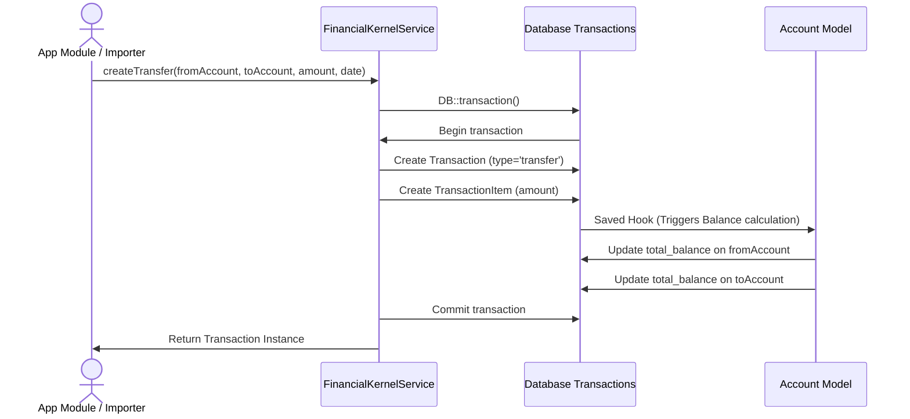
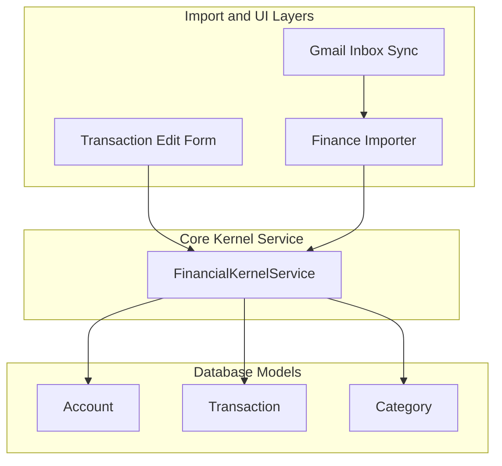

# Financial Kernel Service

The `FinancialKernelService` serves as the core engine and single entry point for all financial mutations within vFOS. It decouples the raw business entities and transactions from external pipelines (such as Gmail ingestion, parsers, and manual UI editors), acting as a strict transactional facade.

---

## 1. Responsibility of the Service
* **Single Source of Truth**: Ensures all mutations (incomes, expenses, transfers, adjustments) pass through a single, controlled class to maintain transactional consistency.
* **ACID Guarantees**: Wraps multi-row DB queries (e.g., transaction record creation and corresponding items) inside database transactions.
* **Decoupled Architecture**: Has zero awareness of external modules (Gmail, scrapers, normalizers, UI requests, etc.). It operates strictly on database entities: `Account`, `Transaction`, and `Category`.

---

## 2. Public APIs

### `createIncome`
Creates an income transaction and its corresponding item. Recalculates the affected account's balance.
```php
public function createIncome(
    int $accountId,
    float $amount,
    string $date,
    ?string $description = null,
    array $metadata = []
): Transaction
```

### `createExpense`
Creates an expense transaction and its corresponding item. Recalculates the affected account's balance.
```php
public function createExpense(
    int $accountId,
    float $amount,
    string $date,
    ?string $description = null,
    array $metadata = []
): Transaction
```

### `createTransfer`
Creates a double-entry internal transfer between two owned accounts. Recalculates balances for both source and destination accounts.
```php
public function createTransfer(
    int $fromAccountId,
    int $toAccountId,
    float $amount,
    string $date,
    ?string $description = null,
    array $metadata = []
): Transaction
```

### `createAdjustment`
Records a valuation adjustment (appreciation or depreciation) on a single account.
```php
public function createAdjustment(
    int $accountId,
    float $amount,
    string $date,
    ?string $description = null,
    array $metadata = []
): Transaction
```

### `refreshAccountBalance`
Recalculates the balance of a single account based on transaction logs and updates the cached column.
```php
public function refreshAccountBalance(int $accountId): float
```

### `refreshAllBalances`
Recalculates balances for all accounts in the database.
```php
public function refreshAllBalances(): void
```

### `calculateNetWorth`
Aggregates balances across all scoped accounts.
```php
public function calculateNetWorth(): float
```

---

## 3. Sequence Diagram (Double-Entry Transfer)



---

## 4. Dependency Graph



---

## 5. Future Migration Plan

1. **Phase 1: Service Introduction (Current)**
   - Introduce `FinancialKernelService` along with unit/feature tests.
   - Zero modifications to existing controllers or import services.
2. **Phase 2: Controller & Ingest Ingestion**
   - Repoint `TransactionController@update` and `TransactionController@store` to run through `FinancialKernelService`.
   - Update `FinanceImporter` to delegate the database inserts and balance updates to `FinancialKernelService`.
3. **Phase 3: Sub-ledger Integrations (Sprint 4.2+)**
   - Adapt `debts`, `receivables`, and `investments` tables to register as Account type variants.
   - Route all adjustments and debt repayments using `createTransfer()` and `createAdjustment()` through the Kernel service.
